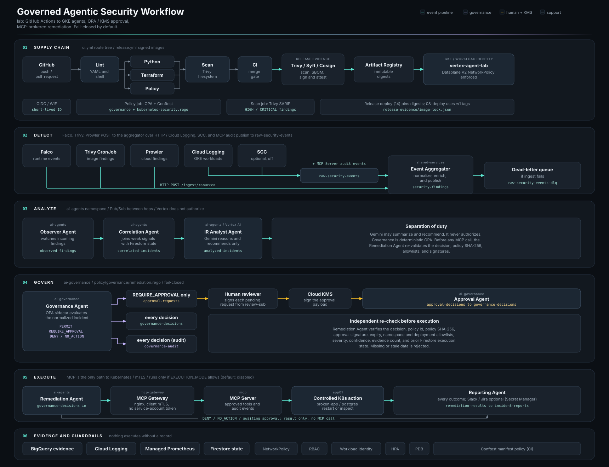

# **Event Pipeline Architecture**

Canonical event flow. Gemini recommends. OPA decides. Cloud KMS binds a human reviewer. MCP is the only Kubernetes execution path.

```text
Falco (falco)  Trivy + Prowler CronJobs (security)     Cloud Logging sink / SCC (optional) / MCP audit events
       |                    |                                        |
       |  HTTP POST /ingest/<source>                                 v
       |                    |                              raw-security-events --(retries)--> raw-security-events-dlq
       v                    v                                        |
Event Aggregator (shared-services) <---------------------------------+
  |
  v
security-findings
  |
  v
Observer Agent (ai-agents)
  |
  v
observed-findings
  |
  v
Correlation Agent + Firestore
  |
  v
correlated-incidents
  |
  v
IR Analyst Agent + Vertex AI / Gemini (recommends only)
  |
  v
analyzed-incidents
  |
  v
Governance Agent + OPA sidecar (ai-governance)
  |
  +--> governance-audit                      (every decision)
  |
  +--> approval-requests + Firestore record  (REQUIRE_APPROVAL only)
  |        |
  |        v
  |    Human reviewer signs with Cloud KMS   (scripts/11-review-approval.sh)
  |        |
  |        v
  |    approval-decisions
  |        |
  |        v
  |    Approval Agent: verifies signature, request hash, expiry
  |        |
  |        v  new decision, decision_source = kms-human-approval
  v        |
governance-decisions  (every decision: PERMIT / DENY / NO_ACTION / REQUIRE_APPROVAL)
  |
  v
Remediation Agent (ai-agents)
  |
  +--> DENY / NO_ACTION / REQUIRE_APPROVAL: result only, no MCP call
  |
  +--> PERMIT: re-validates policy SHA-256, allowlists, approval, expiry, Firestore state
  |      executes only if EXECUTION_MODE allows:
  |        disabled (default)  never
  |        approval-only       KMS-approved decisions only
  |        controlled          policy PERMIT or KMS-approved
  |      |
  |      v
  |    MCP Gateway (mcp-gateway): nginx, client mTLS
  |      |
  |      v
  |    MCP Server (mcp): get_pods / get_logs / restart_deployment, app01 RBAC
  |      |
  |      v
  |    allowlisted action on app01/broken-app
  |      |
  v      v
remediation-results  (every outcome)
  |
  v
Reporting Agent
  |
  +--> incident-reports
  +--> optional Slack / Jira (disabled by default)

Failed agent messages        --> agent-events-dlq
Governance, approval, remediation, and MCP Server logs --> Cloud Logging sink --> BigQuery evidence
```

`AUTOMATION_MODE` defaults to `disabled`, so OPA returns `REQUIRE_APPROVAL` for every actionable incident. Policy-only `PERMIT` needs `AUTOMATION_MODE: controlled` and a HIGH-severity incident that passes every threshold. CRITICAL incidents always need signed human approval.


